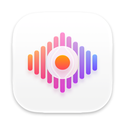
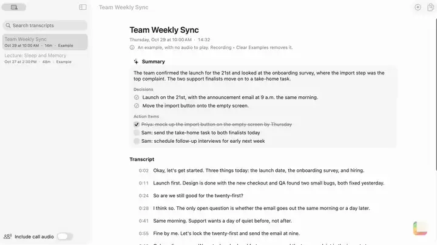

<p align="center"></p>

<h1 align="center">Transcriber</h1>

<p align="center">Records meetings, calls and lectures, transcribes them on your Mac, and sums them up.</p>

<p align="center"><a href="https://lamp.dev/?repo=https://github.com/lampdotdev/transcriber&amp;from=readme"></a></p>

<p align="center"><a href="#build-it-yourself">Build it yourself</a></p>

<p align="center"><a href=".github/showcase/reel.mp4"></a></p>

<p align="center"><a href=".github/showcase/reel.mp4">Watch it with sound</a></p>

## Make Transcriber yours

Each opens Lamp with a copy of Transcriber and that change, ready to send:

- [Show transcripts as chat bubbles](https://lamp.dev/?repo=https://github.com/lampdotdev/transcriber&from=readme&ask=Show%20transcripts%20as%20chat%20bubbles)
- [Email me the action items](https://lamp.dev/?repo=https://github.com/lampdotdev/transcriber&from=readme&ask=Email%20me%20the%20action%20items)
- [Make it a voice diary](https://lamp.dev/?repo=https://github.com/lampdotdev/transcriber&from=readme&ask=Make%20it%20a%20voice%20diary)

## Open it in Lamp

[Lamp](https://lamp.dev) is a Mac app that builds apps from a description and changes them as you ask. [Open Transcriber in Lamp](https://lamp.dev/?repo=https://github.com/lampdotdev/transcriber&from=readme) for a copy of your own, to use and to change as you like, with the credits below kept. Or, in Lamp, choose File → Open from GitHub… and paste `https://github.com/lampdotdev/transcriber`.

## Build it yourself

With Apple's Command Line Tools installed (`xcode-select --install`):

```sh
zsh build.sh
```

The AI inside the app, and anything it does with other apps or devices, goes through Lamp, so those need Lamp open on the same Mac.

## License

MIT. See [LICENSE](LICENSE).
